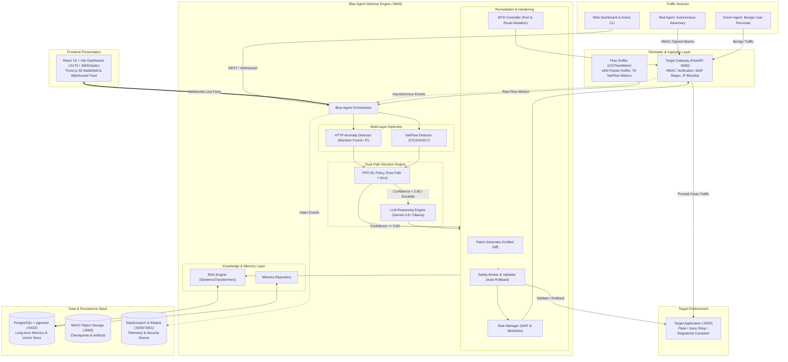
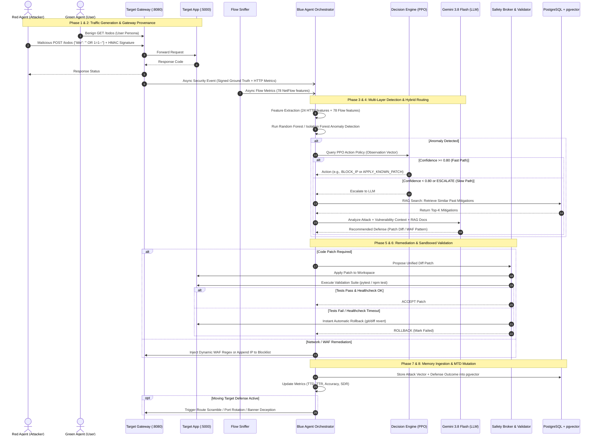
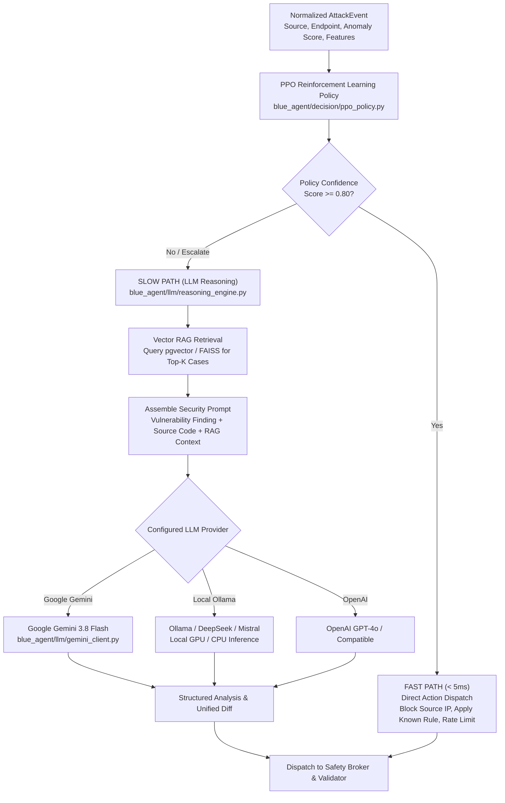

# DefendForge: Collaborative Multi-Agent Autonomous Cyber Defense & Hardening Platform


**DefendForge** is an enterprise-grade, research-grounded autonomous multi-agent cyber defense and active hardening platform for containerized applications. It deploys an adversarial ecosystem featuring an autonomous **Red Agent** (attacker), an autonomous **Blue Agent** (defender), and a **Green Agent** (benign background traffic simulator) around target applications. 

DefendForge combines **machine learning anomaly detection**, **reinforcement learning (PPO)**, **large language models (Google Gemini / Ollama / OpenAI)**, **vector-based RAG memory (pgvector / FAISS)**, **sandboxed patch validation with automatic rollback**, and **self-evolving Moving Target Defense (MTD)**.

---

## Table of Contents

- [Key Highlights & Academic Foundations](#key-highlights--academic-foundations)
- [System Architecture](#system-architecture)
  - [Architecture Diagram](#architecture-diagram)
  - [Container & Network Topology](#container--network-topology)
  - [Core Components Breakdown](#core-components-breakdown)
- [Application Flow & Defense Lifecycle](#application-flow--defense-lifecycle)
  - [End-to-End Sequence Diagram](#end-to-end-sequence-diagram)
  - [Detailed Phase-by-Phase Walkthrough](#detailed-phase-by-phase-walkthrough)
- [The Multi-Agent Ecosystem](#the-multi-agent-ecosystem)
  - [Red Agent (Adversary Engine)](#red-agent-adversary-engine)
  - [Blue Agent (Autonomous Defender)](#blue-agent-autonomous-defender)
  - [Green Agent (Benign Traffic Generator)](#green-agent-benign-traffic-generator)
- [Dual-Path Decision Engine (PPO + Gemini)](#dual-path-decision-engine-ppo--gemini)
- [Safety Broker & Auto-Rollback Contract](#safety-broker--auto-rollback-contract)
- [Moving Target Defense (MTD)](#moving-target-defense-mtd)
- [3D Interactive Dashboard & Arena Battlefield](#3d-interactive-dashboard--arena-battlefield)
- [Target Registration & Manifests](#target-registration--manifests)
- [CLI Arena Runner (`run_arena.py`)](#cli-arena-runner-run_arenapy)
- [Quick Start Guide](#quick-start-guide)
- [Configuration Reference](#configuration-reference)
- [REST API & WebSocket Reference](#rest-api--websocket-reference)
- [Testing & Quality Assurance](#testing--quality-assurance)
- [License](#license)

---

## Key Highlights & Academic Foundations

DefendForge translates foundational multi-agent cybersecurity research into an inspectable, production-ready cyber range:

| Research Area | Academic Citation | DefendForge Implementation |
| :--- | :--- | :--- |
| **Confidence-Gated Hybrid Defense** | *Castro et al., Large Language Models are Autonomous Cyber Defenders* | Two-tier routing: Sub-millisecond PPO RL for known threats; dynamic Gemini LLM reasoning for novel zero-days. |
| **Rollback-Safe Remediation** | *Farzulla & Maksakov, Autonomous Red Team and Blue Team AI (2025)* | Automated AST & diff patching validated via containerized test suites. Zero app downtime through automatic rollback. |
| **Iterative Red-Blue Hardening** | *Huang et al., RvB: Automating AI System Hardening via Iterative Red-Blue Games* | Bounded adversarial campaigns where validated mitigations are ingested into persistent vector memory across rounds. |
| **Realistic Baseline Signal** | *Kiely et al., CAGE Challenge 4 (AI Magazine 2025)* | Integrated Green Agent simulating concurrent user personas to guarantee non-zero False Positive Rate (FPR) and measurable Service Disruption Rate (SDR). |
| **Self-Evolving Moving Target Defense** | *Cao et al., DRL-Based Self-Evolving MTD Against Unknown Attacks* | Proactive surface mutation (port rotation, ephemeral route scrambling, honeypot decoys, banner deception) evaluated via paired comparisons. |
| **Durable Provenance & Cyber Range** | *Emerson et al., CybORG++* | Cryptographic HMAC-SHA256 request signing separating ground truth from detection predictions. |

---

## System Architecture

DefendForge runs as an isolated multi-network Docker stack. Traffic between clients and the vulnerable target application is strictly mediated by the **Target Gateway**, while raw traffic is sniffed by a containerized flow monitor.

### Architecture Diagram



### Container & Network Topology

The system defines four isolated Docker bridge networks in [docker-compose.yml](file:///c:/Users/mugil/OneDrive/Documents/DefendForge/docker-compose.yml):

1. **`target_internal`**: Completely private network. Houses the `target_app`. Direct access from external hosts or Red Agent is blocked. Only the `target_gateway` can bridge traffic into this network.
2. **`user_net`**: Accessible by normal clients, Green Agent, and the Target Gateway.
3. **`red_net`**: Dedicated egress network for the Red Agent. Direct routing to `target_app` is blocked; all traffic is forced through `target_gateway`.
4. **`blue_net`**: Management and defense network linking `blue_agent`, `target_gateway`, `db` (pgvector), `elasticsearch`, `kibana`, and `minio`.

---

## Application Flow & Defense Lifecycle

The core loop of DefendForge runs continuously through an 8-stage lifecycle: **RECON &rarr; PROVENANCE &rarr; DETECT &rarr; ROUTE &rarr; REMEDIATE &rarr; VALIDATE &rarr; HARDEN &rarr; LEARN**.

### End-to-End Sequence Diagram



### Detailed Phase-by-Phase Walkthrough

#### 1. Surface Discovery & Static Reconnaissance (RECON)
- Red Agent executes static audits (`pip-audit`, `npm-audit`, `semgrep`, `bandit`) against the target source repository.
- Performs AST-based route extraction, OpenAPI specification inspection, and crawler-based endpoint discovery via [red_agent/recon/scanner.py](file:///c:/Users/mugil/OneDrive/Documents/DefendForge/red_agent/recon/scanner.py) and [target_platform/discovery.py](file:///c:/Users/mugil/OneDrive/Documents/DefendForge/target_platform/discovery.py).

#### 2. Traffic Generation & Cryptographic Provenance
- Green Agent continuously sends valid, authenticated user requests using realistic browser headers and session cookies.
- Red Agent launches targeted exploits (SQL Injection, XSS, Path Traversal, OS Command Injection, SSRF, Deserialization, Broken Access Control).
- Every Red request is signed using HMAC-SHA256 (`x-defendforge-signature`, `x-defendforge-campaign-id`, `x-defendforge-request-id`).
- The **Target Gateway** verifies the signature using a shared secret. It logs the ground-truth label separately from Blue's detection pipeline, guaranteeing that evaluation metrics (precision, recall, false positives) remain completely uncorrupted.

#### 3. Multi-Layer Anomaly Detection (DETECT)
- **Application Layer**: [blue_agent/detection/random_forest.py](file:///c:/Users/mugil/OneDrive/Documents/DefendForge/blue_agent/detection/random_forest.py) inspects 24 HTTP feature metrics (request size, URI entropy, special character frequencies, SQL keywords, script tags, traversal tokens, latency, status codes).
- **Network Layer**: [blue_agent/detection/cicids_flow_detector.py](file:///c:/Users/mugil/OneDrive/Documents/DefendForge/blue_agent/detection/cicids_flow_detector.py) ingests 78 network flow statistics streamed by the [flow_sniffer/sniffer.py](file:///c:/Users/mugil/OneDrive/Documents/DefendForge/flow_sniffer/sniffer.py) container (Flow Duration, Packet Size Variance, Inter-Arrival Times, TCP Flags).

#### 4. Confidence-Gated Hybrid Decision Routing (ROUTE)
- [blue_agent/decision/decision_engine.py](file:///c:/Users/mugil/OneDrive/Documents/DefendForge/blue_agent/decision/decision_engine.py) evaluates the normalized `AttackEvent`.
- **Fast Path (PPO)**: The Proximal Policy Optimization RL policy ([blue_agent/decision/ppo_policy.py](file:///c:/Users/mugil/OneDrive/Documents/DefendForge/blue_agent/decision/ppo_policy.py)) predicts an action. If policy confidence is $\ge 0.80$, the action executes in under $5\text{ ms}$.
- **Slow Path (Gemini LLM + RAG)**: If confidence is $< 0.80$ or the threat is previously unseen, the event escalates to [blue_agent/llm/reasoning_engine.py](file:///c:/Users/mugil/OneDrive/Documents/DefendForge/blue_agent/llm/reasoning_engine.py). The system queries pgvector/FAISS for similar historical mitigations and prompts the LLM to generate an optimal defense.

#### 5. Defense Synthesis & Remediation (REMEDIATE)
- The system dispatches one of 10 discrete defensive actions defined in [blue_agent/decision/action_space.py](file:///c:/Users/mugil/OneDrive/Documents/DefendForge/blue_agent/decision/action_space.py):
  1. `BLOCK_SOURCE_IP`: Injected into `rules/ip_blocklist.json`.
  2. `RATE_LIMIT_SOURCE`: Dynamic request throttling at the gateway.
  3. `UPDATE_SECURITY_RULE`: Hot-patching gateway WAF regex rules in `rules/waf_rules.json`.
  4. `APPLY_KNOWN_PATCH`: Generating unified code diffs to eliminate application bugs.
  5. `DISABLE_ENDPOINT`: Temporary fail-closed circuit breaker.
  6. `ROLLBACK_PREVIOUS`: Undo a failing change.

#### 6. Safety-Broker Validation & Auto-Rollback Contract (VALIDATE)
- Automated code modifications are **never** blindly committed.
- [blue_agent/remediation/validator.py](file:///c:/Users/mugil/OneDrive/Documents/DefendForge/blue_agent/remediation/validator.py) applies the unified diff to the target repository.
- Executes the target application's declared test suite (e.g. `pytest tests` or `npm test`) and polls the `/health` endpoint.
- **ACCEPT**: If all tests pass and health returns HTTP 200, the patch is finalized.
- **ROLLBACK**: If any test fails, syntax errors are detected, or the health check times out, the patch is reversed immediately via git/diff revert, ensuring 0% accidental service disruption.

#### 7. Vector Memory Ingestion & Hardening (HARDEN & LEARN)
- The attack pattern, payload tokens, vulnerability type, and accepted remediation are embedded using `all-MiniLM-L6-v2` and saved to PostgreSQL (`pgvector`).
- On future rounds, identical or syntactically similar attacks are instantly resolved via RAG lookup and the PPO Fast Path, bypassing slow LLM escalation.
- Decisions and performance metrics are indexed into **Elasticsearch** and rendered in real-time on the **Kibana** and **React** dashboards.

#### 8. Moving Target Defense Mutation (MTD)
- Proactive surface shifts trigger: dynamic port rotation, routing alias generation, decoy honeypot injection, and server header deception.

---

## The Multi-Agent Ecosystem

```
+-----------------------------------------------------------------------------------+
|                              DEFENDFORGE ARENA                                    |
|                                                                                   |
|   +-----------------------+   +-----------------------+   +-------------------+   |
|   |       RED AGENT       |   |      GREEN AGENT      |   |    BLUE AGENT     |   |
|   |  Adversary Engine     |   |  Benign Background    |   |  Autonomous       |   |
|   |                       |   |                       |   |  Defender         |   |
|   | - Surface Discovery   |   | - 6 User Personas     |   | - Anomaly Detect  |   |
|   | - SAST / SCA Audits   |   | - Concurrent Requests |   | - PPO Policy      |   |
|   | - MITRE ATT&CK Plans  |   | - Session Simulation  |   | - Gemini 3.8 LLM  |   |
|   | - Payload Obfuscation |   | - Baseline Latency    |   | - Safe Patching   |   |
|   | - HMAC Signatures     |   | - SDR Monitoring      |   | - MTD Mutation    |   |
|   +-----------+-----------+   +-----------+-----------+   +---------+---------+   |
|               |                           |                         |             |
|               +------------+  +-----------+                         |             |
|                            |  |                                     |             |
|                            v  v                                     v             |
|                  +-----------------------+              +---------------------+   |
|                  |    TARGET GATEWAY     |<-------------| Dynamic Rules & WAF |   |
|                  |  HMAC & WAF Proxy     |              +---------------------+   |
|                  +-----------+-----------+                                        |
|                              |                                                    |
|                              v                                                    |
|                  +-----------------------+              +---------------------+   |
|                  |      TARGET APP       |<-------------| Container Test &    |   |
|                  | (Vulnerable Container)|              | Validation Suite    |   |
|                  +-----------------------+              +---------------------+   |
+-----------------------------------------------------------------------------------+
```

### Red Agent (Adversary Engine)
- **Directory**: [red_agent/](file:///c:/Users/mugil/OneDrive/Documents/DefendForge/red_agent/)
- **Planner & Execution**: [red_agent/autonomous_campaign.py](file:///c:/Users/mugil/OneDrive/Documents/DefendForge/red_agent/autonomous_campaign.py) and [red_agent/planner.py](file:///c:/Users/mugil/OneDrive/Documents/DefendForge/red_agent/planner.py).
- **Knowledge Base**: Curated catalog of MITRE ATT&CK techniques ([red_agent/mitre_techniques.json](file:///c:/Users/mugil/OneDrive/Documents/DefendForge/red_agent/mitre_techniques.json)).
- **Safety Guardrails**: [red_agent/guardrails.py](file:///c:/Users/mugil/OneDrive/Documents/DefendForge/red_agent/guardrails.py) enforces strict network confinement. Any request targeting non-whitelisted IP ranges, public domains, or cloud metadata endpoints (`169.254.169.254`) is immediately aborted.

### Blue Agent (Autonomous Defender)
- **Directory**: [blue_agent/](file:///c:/Users/mugil/OneDrive/Documents/DefendForge/blue_agent/)
- **Orchestrator**: [blue_agent/orchestrator.py](file:///c:/Users/mugil/OneDrive/Documents/DefendForge/blue_agent/orchestrator.py).
- **Detection**: Random Forest and Isolation Forest classifiers operating with an empirically tuned false-positive threshold ($\le 5\%$).
- **Safety Broker**: [blue_agent/safety/broker.py](file:///c:/Users/mugil/OneDrive/Documents/DefendForge/blue_agent/safety/broker.py) enforces strict typed parameter checking and a rigid allowlist of executable tools (`block_ip`, `rate_limit`, `apply_patch`, `run_tests`, `rollback_patch`, etc.).

### Green Agent (Benign Traffic Generator)
- **Directory**: [green_agent/](file:///c:/Users/mugil/OneDrive/Documents/DefendForge/green_agent/)
- **Traffic Generator**: [green_agent/traffic_generator.py](file:///c:/Users/mugil/OneDrive/Documents/DefendForge/green_agent/traffic_generator.py).
- **User Personas**: [green_agent/user_personas.py](file:///c:/Users/mugil/OneDrive/Documents/DefendForge/green_agent/user_personas.py) simulates concurrent human behaviors (Anonymous Browsers, Authenticated Regular Users, Power Shoppers, Content Creators, Administrators).
- **Metric Verification**: Allows DefendForge to compute genuine operational metrics:
  - **FPR (False Positive Rate)**: Percentage of benign requests erroneously blocked by WAF or IP rules.
  - **SDR (Service Disruption Rate)**: Percentage of benign requests that return HTTP 5xx or fail validation tests during patching.

---

## Dual-Path Decision Engine (PPO + Gemini)

The Blue Agent implements a hybrid architecture reconciling sub-millisecond operational latency with deep generative reasoning:



---

## Safety Broker & Auto-Rollback Contract

Autonomous code modification without validation introduces severe availability risks. DefendForge resolves this with an explicit **Sandboxed Validation Contract**:

```
[Generated Unified Diff Patch]
               │
               ▼
┌───────────────────────────────┐
│     Safety Broker (broker.py) │ ──> Schema & Tool Allowlist Check
└──────────────┬────────────────┘
               ▼
┌───────────────────────────────┐
│   Apply Patch to Workspace   │ ──> In-place git apply / unified diff
└──────────────┬────────────────┘
               ▼
┌───────────────────────────────┐
│ Run Target Validation Command │ ──> argv-only command (e.g. pytest tests)
└──────────────┬────────────────┘     Enforces timeout and workspace confinement
               │
       ┌───────┴───────┐
       ▼               ▼
 [Tests Pass]     [Tests Fail / Timeout]
       │               │
       ▼               ▼
┌──────────────┐ ┌────────────────────────────────────────┐
│    ACCEPT    │ │                ROLLBACK                │
│ Patch Sealed │ │ Revert Diff to Restored Clean State    │
│ Update State │ │ Log Rollback Event in Telemetry Feed   │
└──────────────┘ └────────────────────────────────────────┘
```

---

## Moving Target Defense (MTD)

Implemented in [mtd/](file:///c:/Users/mugil/OneDrive/Documents/DefendForge/mtd/), DefendForge features a self-evolving Moving Target Defense engine:

1. **Port Rotation**: Periodically rotates listening gateway ports across an ephemeral pool.
2. **Route Scrambling**: Generates cryptographic URL aliases for critical endpoints, rendering hardcoded exploit paths obsolete.
3. **Decoy Honeypots**: Spawns synthetic vulnerable decoy endpoints that alert and trap adversarial scanners.
4. **Header Deception**: Shuffles HTTP Server and banner headers (e.g. alternating between NGINX, Apache, Cloudflare, Microsoft-IIS) to defeat fingerprinting.
5. **Paired Comparison Evaluator**: [mtd/evaluator.py](file:///c:/Users/mugil/OneDrive/Documents/DefendForge/mtd/evaluator.py) runs automated experiments against held-out zero-day exploits, comparing Static Baseline vs MTD-Enabled targets to quantify attack success reduction.

---

## 3D Interactive Dashboard & Arena Battlefield

The frontend ([frontend/](file:///c:/Users/mugil/OneDrive/Documents/DefendForge/frontend/)) is built with **React 19**, **Vite**, and **Three.js**:

- **3D Arena Battlefield** ([ArenaBattlefield.jsx](file:///c:/Users/mugil/OneDrive/Documents/DefendForge/frontend/src/components/ArenaBattlefield.jsx)): Interactive Three.js spatial canvas rendering live particle attack vectors flowing from Red to the Gateway, and defensive shields deployed by Blue.
- **Metrics HUD** ([MetricsHUD.jsx](file:///c:/Users/mugil/OneDrive/Documents/DefendForge/frontend/src/components/MetricsHUD.jsx)): Real-time gauge dials for Time-to-Detect (TTD), Time-to-Remediate (TTR), Defense Success Rate (DSR), False Positive Rate (FPR), and Service Disruption Rate (SDR).
- **Live Event Feed** ([LiveEventFeed.jsx](file:///c:/Users/mugil/OneDrive/Documents/DefendForge/frontend/src/components/LiveEventFeed.jsx)): Low-latency event stream connected over WebSocket (`/ws`) streaming audit events, raw netflows, anomaly alerts, routing decisions, patch outcomes, and rollbacks.
- **Attack Trigger Deck** ([AttackTriggerDeck.jsx](file:///c:/Users/mugil/OneDrive/Documents/DefendForge/frontend/src/components/AttackTriggerDeck.jsx)): Interactive buttons to trigger pre-configured exploits (SQLi, XSS, Path Traversal, Command Injection) or start continuous autonomous campaigns.

---

## Target Registration & Manifests

DefendForge can harden **any** local containerized application. Targets are registered via JSON manifests placed in [targets/](file:///c:/Users/mugil/OneDrive/Documents/DefendForge/targets/):

```json
{
  "name": "custom-service",
  "service": "target_gateway",
  "base_url": "http://target_gateway:8080",
  "health": {
    "path": "/health"
  },
  "discovery": {
    "openapi_path": "/openapi.json",
    "crawl_enabled": true,
    "max_depth": 2
  },
  "limits": {
    "allowed_methods": ["GET", "POST", "PUT", "PATCH", "DELETE"]
  },
  "validation": {
    "command": ["pytest", "tests"],
    "working_dir": ".",
    "timeout": 300
  },
  "audit": {
    "source_path": "/target",
    "tools": ["pip-audit", "npm-audit", "semgrep"],
    "timeout_seconds": 300
  }
}
```

Pre-configured target manifests include:
- `default.json`: Vulnerable Flask App ([target_app/](file:///c:/Users/mugil/OneDrive/Documents/DefendForge/target_app/))
- `juice-shop.json`: OWASP Juice Shop
- `pygoat.json`: OWASP PyGoat
- `gitea.json`: Gitea Git Service
- `flaskbb.json`: FlaskBB Forum

---

## CLI Arena Runner (`run_arena.py`)

Run autonomous battles directly from your terminal using [run_arena.py](file:///c:/Users/mugil/OneDrive/Documents/DefendForge/run_arena.py):

```bash
# Interactive mode (prompts for target URL, workspace path, and round limits)
python run_arena.py

# Direct CLI execution against running gateway:
python run_arena.py --target-url http://localhost:8080 --target-path ./target_app --rounds 5 --events 10

# Standalone in-process execution (without running Docker):
python run_arena.py --target-url http://localhost:5000 --target-path ./target_app --standalone
```

---

## Quick Start Guide

### Prerequisites
- Docker & Docker Compose (v2.20+)
- Python 3.10+ (for local CLI / test execution)
- Node.js 18+ (for frontend development)

### 1. Clone & Configure Environment

```bash
git clone https://github.com/your-username/DefendForge.git
cd DefendForge

# Copy example environment configuration
cp .env.example .env
```

Edit `.env` to supply your LLM credentials:

```bash
# Primary LLM provider (gemini, ollama, or openai)
LLM_PROVIDER=gemini
GEMINI_API_KEY=your_google_gemini_api_key_here
GEMINI_MODEL=gemini-3.8-flash
```

### 2. Launch Stack via Docker Compose

```bash
docker-compose up --build -d
```

Verify service availability:
- **Web Dashboard**: [http://localhost:8000](http://localhost:8000) (or [http://localhost:5173](http://localhost:5173) in Vite dev mode)
- **Target Gateway**: [http://localhost:8080](http://localhost:8080)
- **Blue Agent API Docs**: [http://localhost:8000/docs](http://localhost:8000/docs)
- **Kibana Analytics**: [http://localhost:5601](http://localhost:5601)
- **MinIO Storage Console**: [http://localhost:9001](http://localhost:9001)

### 3. Trigger an Autonomous Arena Campaign

From the Web Dashboard, click **Start Autonomous**, or execute via curl:

```bash
curl -X POST http://localhost:8000/api/red/campaign/start \
  -H "Content-Type: application/json" \
  -d '{"rounds": 5, "max_events": 25}'
```

---

## Configuration Reference

Key environment variables in [blue_agent/config.py](file:///c:/Users/mugil/OneDrive/Documents/DefendForge/blue_agent/config.py) and [.env](file:///c:/Users/mugil/OneDrive/Documents/DefendForge/.env):

| Variable | Description | Default |
| :--- | :--- | :--- |
| `LLM_PROVIDER` | LLM reasoning engine (`gemini`, `ollama`, `openai`, `deepseek`) | `gemini` |
| `GEMINI_API_KEY` | Google Gemini API key | `""` |
| `GEMINI_MODEL` | Gemini model variant | `gemini-3.8-flash` |
| `PPO_CONFIDENCE_THRESHOLD` | Confidence cutoff between Fast Path (PPO) and Slow Path (LLM) | `0.80` |
| `DETECTION_MODEL_PATH` | Path to trained HTTP anomaly detection model | `models/random_forest_24.joblib` |
| `TARGET_APP_URL` | Upstream target application URL | `http://target_gateway:8080` |
| `VALIDATION_TIMEOUT` | Max execution time (seconds) for patch test validation | `300` |
| `RED_AUTO_START` | Whether Red Agent automatically initiates attacks on startup | `false` |
| `RED_CAMPAIGN_ROUNDS` | Default number of rounds per autonomous attack campaign | `5` |
| `RED_CAMPAIGN_EVENTS` | Max attack events per round | `25` |
| `PROVENANCE_SECRET` | HMAC secret for Red Agent request signing | `local-development-secret` |
| `POSTGRES_DB` | PostgreSQL database name for pgvector memory | `bluememory` |

---

## REST API & WebSocket Reference

The Blue Agent provides an extensive OpenAPI-compliant REST interface:

| Endpoint | Method | Purpose |
| :--- | :---: | :--- |
| `/` | `GET` | Serves the 3D Web Dashboard |
| `/ws` | `WS` | Real-time WebSocket event and telemetry stream |
| `/api/health` | `GET` | Health status of Blue Agent and attached storage |
| `/api/events` | `POST` | Ingestion endpoint for gateway security events |
| `/api/netflow` | `POST` | Ingestion endpoint for raw network flow metrics from `flow_sniffer` |
| `/api/security-events` | `GET` | Query durable security events with ground-truth separation |
| `/api/arena/start` | `POST` | Start multi-round Red vs Blue battle arena |
| `/api/arena/stop` | `POST` | Stop running arena |
| `/api/attack/trigger` | `POST` | Dispatch specific attack scenario (SQLi, XSS, etc.) |
| `/api/attack/presets` | `GET` | List available attack presets |
| `/api/red/campaign/start` | `POST` | Initiate autonomous Red campaign |
| `/api/red/campaign` | `GET` | Get autonomous campaign status and progress |
| `/api/mtd/evaluate` | `POST` | Run paired comparison evaluation (Static Baseline vs MTD) |
| `/api/mtd/status` | `GET` | View current MTD configuration (ports, aliases, decoys) |
| `/api/audit` | `POST` | Execute on-demand SAST / SCA security audit |
| `/api/metrics` | `GET` | Retrieve real-time performance metrics (TTD, TTR, precision, recall) |
| `/api/memory` | `GET` | Inspect Blue Agent vector memory records |
| `/api/rules/waf` | `GET` | Inspect active gateway WAF rules |
| `/api/rules/blocklist`| `GET` | Inspect active IP blocklists |

---

## Testing & Quality Assurance

DefendForge includes a comprehensive pytest test suite with **over 210 unit and integration tests** covering all modules:

```bash
# Run the complete test suite
pytest tests/

# Run targeted test suites
pytest tests/test_orchestrator.py
pytest tests/test_decision.py
pytest tests/test_safety_broker.py
pytest tests/test_mtd.py
pytest tests/test_rag.py
```

---

## License

This project is licensed under the MIT License - see the [LICENSE](file:///c:/Users/mugil/OneDrive/Documents/DefendForge/LICENSE) file for details.
